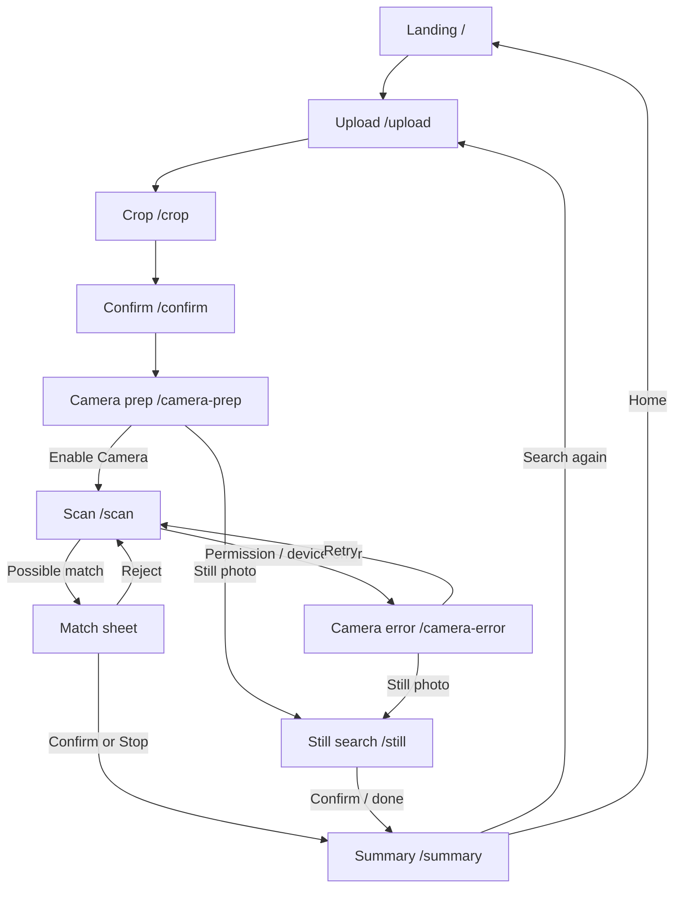
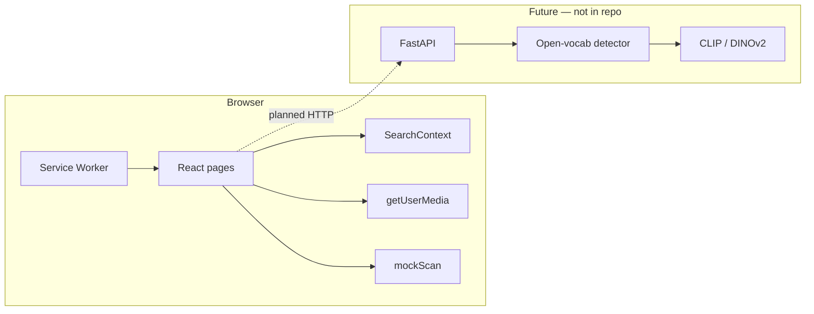

# FindIt AI

**Real-time visual search UI for locating lost belongings — Phase 1 (mocked AI pipeline) + installable PWA.**

Scan with a reference photo, review **possible** matches, and confirm yourself. The product never claims guaranteed identification.

[](https://react.dev/)
[](https://www.typescriptlang.org/)
[](https://vite.dev/)
[](https://tailwindcss.com/)
[](https://vite-pwa-org.netlify.app/)
[](#limitations--future-improvements)

> **Honesty first:** Live camera preview uses the browser `getUserMedia` API. Detection and similarity results in this phase are **deterministic mocks** — not YOLO, CLIP, or DINOv2 inference. See [AI implementation](#ai-implementation).

**Repository:** [github.com/anushkagupta6155-ship-it/Findit-ai](https://github.com/anushkagupta6155-ship-it/Findit-ai)

---

## Table of contents

- [Overview](#overview)
- [Key features](#key-features)
- [Progressive Web App](#progressive-web-app)
- [Install on phone](#install-on-phone)
- [How it works](#how-it-works)
- [Screenshots / demo](#screenshots--demo)
- [Technology stack](#technology-stack)
- [System architecture](#system-architecture)
- [Project structure](#project-structure)
- [Installation & setup](#installation--setup)
- [Deployment](#deployment)
- [API documentation](#api-documentation)
- [AI implementation](#ai-implementation)
- [Privacy & security](#privacy--security)
- [Limitations & future improvements](#limitations--future-improvements)
- [Testing](#testing)
- [Contributing](#contributing)
- [Documentation](#documentation)
- [Author & acknowledgements](#author--acknowledgements)

---

## Overview

**FindIt AI** helps ordinary users search a physical area for a lost item by comparing a **reference image** (and optional metadata) to candidates highlighted in a live camera view or a still scene photo.

| Problem | Approach |
|---------|----------|
| You lost a wallet, keys, earbuds, or bag and have (or can find) a photo of it | Upload / capture up to 3 references, crop the object, then scan |
| Generic “AI found it” UIs overclaim identity | UI uses **match bands** (“Strong possible match”, etc.) and requires human confirm/reject |
| Camera may be unavailable | Still-image fallback and dedicated camera-error recovery screens |

**Current value:** a complete, mobile-first product flow with real camera access, image validation, session state, a mocked match layer, and an **installable PWA** (standalone home-screen app) via `vite-plugin-pwa`.

---

## Key features

### Implemented

- Landing page with product explanation and CTA
- Reference intake: gallery upload, camera capture, product image URL, and demo samples
- Up to **3** reference photos; crop / select-object (react-easy-crop)
- Optional metadata: name, colour, brand, notes
- Client-side image validation (JPEG / PNG / WebP, max 5 MB, small-size warning)
- Camera preparation + explicit **Enable Camera** permission gate
- Live scan: `getUserMedia`, zoom, pause / resume / stop, torch when supported
- Match bands (not raw % as primary UI); confirm / reject; vibration / sound feedback hooks
- Still-image search fallback + camera error recovery
- Search summary
- **PWA:** web manifest, service worker, app icons, install prompt / iOS hint, update toast

### Planned / in development (not implemented yet)

- FastAPI backend and HTTP scan APIs
- Open-vocabulary detection (YOLO-World / OWL-ViT) + COCO YOLO baseline
- CLIP vs DINOv2 evaluation and calibrated thresholds
- Evaluation dataset; Postgres history / feedback logs
- Hugging Face Spaces Docker for the ML API

Roadmap: [`docs/REVISED_PLAN.md`](docs/REVISED_PLAN.md) · R&D: [`docs/RESEARCH.md`](docs/RESEARCH.md)

---

## Progressive Web App

FindIt AI is configured as a **Progressive Web App** so users can install it from the browser (no Play Store / App Store account required).

| Item | Detail |
|------|--------|
| Plugin | `vite-plugin-pwa` with `registerType: 'autoUpdate'` |
| Manifest | `name`: FindIt AI · `short_name`: FindIt · `display`: standalone · `orientation`: portrait |
| Theme | `theme_color` / `background_color`: `#0b0f14` (design tokens) |
| Icons | `public/icons/icon-192.png`, `icon-512.png`, `icon-512-maskable.png`, `apple-touch-icon.png` |
| Start URL / scope | `/` |
| SPA routing | Workbox `navigateFallback` → `index.html` (deep links work in standalone) |

### Caching rules

| Resource | Strategy |
|----------|----------|
| Built JS / CSS / HTML / icons (and other static build assets) | **Precache** (revisioned; refreshed on new deploy) |
| Google Fonts | Runtime cache with expiration |
| Future `/api/*` | **NetworkOnly** (never cached) |
| Camera frames / uploaded image blobs | **Not cached** (in-memory / data URLs only; not SW assets) |

When a new version is deployed, users see a small **“New version available. Refresh”** toast (`PwaUpdateToast`).

### Offline behaviour (honest)

- The **app shell** (cached static assets) may load offline.
- **Live camera scanning does not work offline** and is not claimed to.
- No backend/auth responses are cached.

---

## Install on phone

Requires a **public HTTPS** URL (e.g. Vercel production). Camera also requires HTTPS on real devices (except `localhost`).

### Android (Chrome)

1. Open the deployed site in Chrome.
2. Use the in-app **Install app** button when shown, or Chrome menu → **Install app** / **Add to Home screen**.
3. Open **FindIt** from the home screen (standalone, no browser chrome).
4. Run a search and allow camera when prompted.

### iPhone (Safari)

1. Open the site in **Safari** (not Chrome for iOS install).
2. Tap **Share** → **Add to Home Screen**.
3. Confirm **Add**.
4. Launch from the home screen and allow camera when scanning.

> iOS does not expose `beforeinstallprompt`. The app shows a one-time hint: Share → Add to Home Screen.

---

## How it works

### User journey

1. **Landing** — Start a search.
2. **Upload** — Add 1–3 references and optional details.
3. **Crop** — Frame the lost object.
4. **Confirm** — Review references.
5. **Camera prep** — Enable camera or use still-photo fallback.
6. **Scan** — Live preview; mock pipeline surfaces candidates.
7. **Match sheet** — Confirm or keep scanning.
8. **Summary** — Session stats.

### User-flow diagram



### Routes

| Path | Screen |
|------|--------|
| `/` | Landing |
| `/upload` | Item / reference intake |
| `/crop` | Object crop |
| `/confirm` | Reference confirmation |
| `/camera-prep` | Permission education |
| `/scan` | Live scanning |
| `/camera-error` | Camera failure recovery (`?kind=…`) |
| `/still` | Still-image fallback |
| `/summary` | Search summary |

---

## Screenshots / demo

**Live demo:** use your Vercel production URL after deploy (HTTPS).

**In-repo screenshots:** none checked in yet — add under `docs/screenshots/` if desired.

---

## Technology stack

### Currently used

| Layer | Technology | Purpose |
|-------|------------|---------|
| UI | **React 19** | SPA |
| Language | **TypeScript** | Typed app code |
| Bundler | **Vite 8** | Dev server + production build |
| PWA | **vite-plugin-pwa** (Workbox) | Manifest, service worker, auto-update |
| Routing | **React Router DOM 7** | Multi-step client routes |
| Styling | **Tailwind CSS 4** | Mobile-first UI |
| Crop | **react-easy-crop** | Reference object crop + zoom |
| Icons (UI) | **lucide-react** | Install / scan controls |
| Camera | **getUserMedia** | Live preview on `/scan` |
| Session | **React Context** | In-memory search session |
| Mock AI | `src/data/mockScan.ts` | Deterministic candidates |
| Hosting | **Vercel** | Static SPA + HTTPS (`vercel.json` SPA rewrite) |

### Planned

| Layer | Technology |
|-------|------------|
| Backend | FastAPI |
| Detection / similarity | YOLO-World or OWL-ViT; CLIP / DINOv2 |
| Database | PostgreSQL |
| ML host | Hugging Face Spaces (Docker) |

---

## System architecture

Frontend-only SPA today. No REST API or model server in this repo.



---

## Project structure

```text
Findit-ai/                   # findit-ai @ 0.1.0
├── docs/
│   ├── RESEARCH.md
│   └── REVISED_PLAN.md
├── public/
│   ├── favicon.svg
│   ├── icons/               # PWA icons (192, 512, maskable, apple-touch)
│   └── samples/             # Demo references
├── src/
│   ├── App.tsx              # Routes + InstallPrompt + PwaUpdateToast
│   ├── components/
│   │   ├── InstallPrompt.tsx
│   │   ├── PwaUpdateToast.tsx
│   │   └── …                # Brand, MatchSheet, ScanOverlay, …
│   ├── context/
│   ├── data/
│   ├── hooks/               # useTorch, useCameraZoom, useMatchFeedback
│   ├── lib/
│   ├── pages/
│   ├── types/
│   └── vite-env.d.ts        # vite-plugin-pwa types
├── index.html               # theme-color + Apple web-app meta
├── vercel.json              # SPA rewrite → index.html
├── vite.config.ts           # Vite + Tailwind + PWA plugin
└── package.json
```

---

## Installation & setup

### Prerequisites

- Node.js **20+**
- npm
- Chrome (or similar) with camera for `/scan`
- Phone testing: **HTTPS** deploy (or localhost / tunnel)

### Clone & run

```bash
git clone https://github.com/anushkagupta6155-ship-it/Findit-ai.git
cd Findit-ai
npm install
npm run dev
```

- Local: [http://localhost:5173/](http://localhost:5173/)
- Note: service worker is **disabled in dev** (`devOptions.enabled: false`). Use production preview to test PWA:

```bash
npm run build
npm run preview
```

Then open the preview URL → DevTools → **Application** → Manifest + Service Workers.

### Environment variables

**None required** for the current frontend. No `.env` in the repo.

### Backend

**Not present.** No FastAPI (or other) server in this repository.

### Quick demo path

1. **Find my lost item** → pick a **Demo** sample  
2. Crop → Confirm → **Enable Camera**  
3. Wait for mocked **Strong possible match** (~7s)  
4. Confirm / reject → **Summary**

---

## Deployment

Configured for **Vercel** (static Vite build + SPA rewrite in `vercel.json`).

```json
{ "rewrites": [{ "source": "/(.*)", "destination": "/index.html" }] }
```

Typical flow: push to `main` → Vercel builds `npm run build` → serves `dist/` over HTTPS.

After deploy, verify:

1. `https://<your-app>/manifest.webmanifest` loads  
2. Service worker registers (Application tab)  
3. Install / Add to Home Screen works on a phone  
4. Camera permission works in standalone mode  

---

## API documentation

**No HTTP APIs are implemented.** Future `/api/*` routes are configured as **NetworkOnly** in the service worker so they will not be cached when added.

---

## AI implementation

| Concern | Today |
|---------|--------|
| Detection / similarity | **Mocked** (`mockScan.ts` + `matchBands.ts`) |
| Match bands | Strong / Possible / Weak; raw score in technical details only |
| Stability | `STABLE_HIT_FRAMES = 3` before alert |
| Thresholds | Placeholder — not calibrated (`docs/RESEARCH.md`) |

Not in this repo: YOLO-World, OWL-ViT, CLIP, DINOv2, OpenCV, PyTorch.

---

## Privacy & security

| Topic | Behaviour |
|-------|-----------|
| Camera | Only after **Enable Camera** |
| Frames | Local preview; not uploaded in current build |
| References | In-memory session (refresh clears search state) |
| SW cache | Static assets only — no camera frames, no `/api/*` |
| Secrets | None |

Install-hint dismissal on iOS uses `localStorage` (`findit-ios-install-hint-dismissed`) only.

---

## Limitations & future improvements

### Current limitations

- AI is **simulated**
- Search session is not persisted across refresh
- No backend / accounts / history
- Offline ≠ full product (no live scan offline)
- Phone install / standalone camera: verify on your HTTPS deploy

### Future improvements

See [`docs/REVISED_PLAN.md`](docs/REVISED_PLAN.md).

---

## Testing

| Command | Purpose |
|---------|---------|
| `npm run lint` | oxlint |
| `npm run build` | `tsc -b` + Vite build (+ generates `dist/sw.js`, manifest) |
| `npx tsc --noEmit` | Typecheck only |
| `npm run preview` | Production preview for SW / manifest checks |

**PWA checks (local preview or production):**

1. Application → Manifest valid; icons 192 / 512 load  
2. Service worker **activated** and controlling the page  
3. Hard refresh still serves app; update toast path after a new deploy  
4. Camera flow still works after SW registration  

**Not present:** automated unit/e2e suite.

---

## Contributing

1. Prefer small PRs; do not fake live model accuracy in the UI.  
2. Run `npm run lint` and `npm run build` before opening a PR.  
3. Update `docs/RESEARCH.md` when recording real ML metrics.

---

## License

**No `LICENSE` file** in the project root yet. Do not assume open-source reuse rights until one is added.

---

## Documentation

| Doc | Description |
|-----|-------------|
| [`docs/REVISED_PLAN.md`](docs/REVISED_PLAN.md) | Product / tech decisions |
| [`docs/RESEARCH.md`](docs/RESEARCH.md) | R&D log |

---

## Author & acknowledgements

| Field | Value |
|-------|--------|
| Repository | [anushkagupta6155-ship-it/Findit-ai](https://github.com/anushkagupta6155-ship-it/Findit-ai) |
| Live demo | Your Vercel HTTPS URL after deploy |

Built as a CS portfolio / interview project: production-style UX + PWA first, then measurable vision models.

Acknowledgements: React, Vite, Tailwind, React Router, vite-plugin-pwa / Workbox maintainers.

---

<sub>Phase 1 + PWA · findit-ai@0.1.0 · Frontend SPA with mocked match pipeline</sub>
