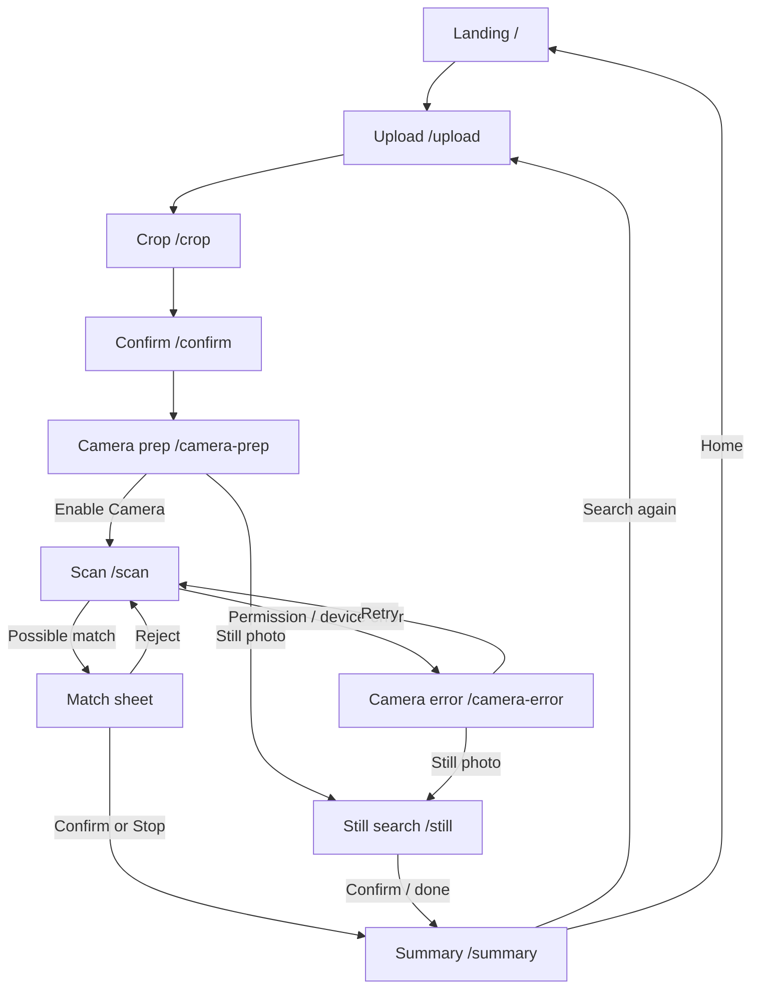
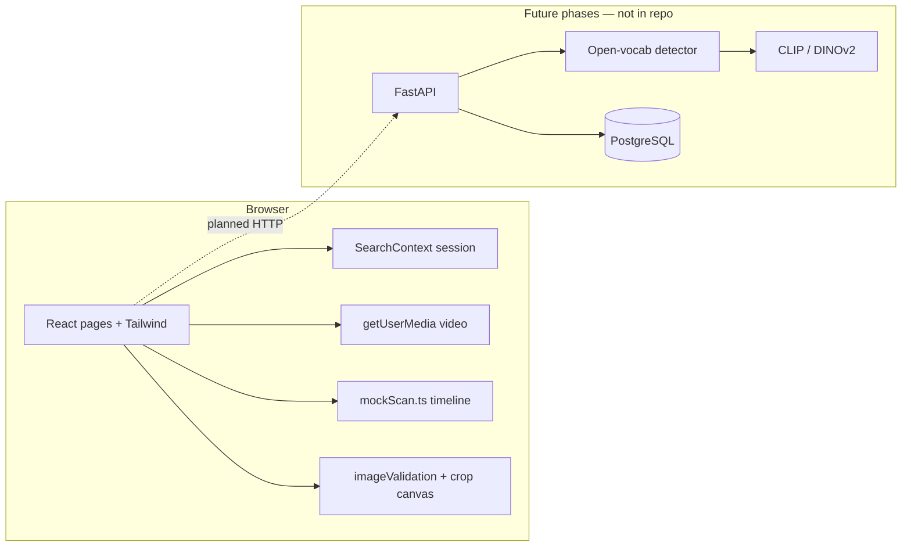

# FindIt AI

**Real-time visual search UI for locating lost belongings — Phase 1 (mocked AI pipeline).**

Scan with a reference photo, review **possible** matches, and confirm yourself. The product never claims guaranteed identification.

[](https://react.dev/)
[](https://www.typescriptlang.org/)
[](https://vite.dev/)
[](https://tailwindcss.com/)
[](#limitations--future-improvements)

> **Honesty first:** Live camera preview uses the browser `getUserMedia` API. Detection and similarity results in this phase are **deterministic mocks** — not YOLO, CLIP, or DINOv2 inference. See [AI Implementation](#ai-implementation).

---

## Table of contents

- [Overview](#overview)
- [Key features](#key-features)
- [How it works](#how-it-works)
- [Screenshots / demo](#screenshots--demo)
- [Technology stack](#technology-stack)
- [System architecture](#system-architecture)
- [Project structure](#project-structure)
- [Installation & setup](#installation--setup)
- [API documentation](#api-documentation)
- [AI implementation](#ai-implementation)
- [Privacy & security](#privacy--security)
- [Limitations & future improvements](#limitations--future-improvements)
- [Testing](#testing)
- [Contributing](#contributing)
- [Documentation](#documentation)
- [Author & acknowledgements](#author--acknowledgements)

---

## Overview

**FindIt AI** helps ordinary users search a physical area for a lost item by comparing a **reference image** (and optional metadata) to candidates highlighted in a live camera view or a still scene photo.

| Problem | Approach |
|---------|----------|
| You lost a wallet, keys, earbuds, or bag and have (or can find) a photo of it | Upload / capture up to 3 references, crop the object, then scan |
| Generic “AI found it” UIs overclaim identity | UI uses **match bands** (“Strong possible match”, etc.) and requires human confirm/reject |
| Camera may be unavailable | Still-image fallback and dedicated camera-error recovery screens |

**Current value (Phase 1):** a complete, mobile-first product flow with real camera access, image validation, session state, and a swappable mock match layer — ready for a FastAPI + vision backend in later phases.

---

## Key features

### Implemented (Phase 1)

- Landing page with product explanation and CTA
- Reference intake: gallery upload, camera capture (`capture="environment"`), product image URL, and demo samples
- Up to **3** reference photos with remove support
- Optional metadata: name, colour, brand, notes
- Client-side image validation (JPEG / PNG / WebP, max 5 MB, soft-size warning)
- Per-photo **crop / select-object** step
- Reference confirmation screen
- Camera preparation + explicit **Enable Camera** permission gate
- Live scan view with `getUserMedia`, pause / resume / stop, guidance tips
- Deterministic **mocked** candidates, overlays, and match bottom sheet
- Match bands (not raw % as primary UI); expandable technical score details
- Confirm / reject match; rejected IDs suppressed for the rest of the scan session
- Vibration + short chime hooks on mock match alert (browser permitting)
- Camera error states (`permission-denied`, `not-found`, `not-supported`, `in-use`, `unknown`)
- Still-image search fallback
- Search summary (duration, candidates, possible matches, confirm/reject counts)
- In-memory session via React context (`SearchProvider`)

### Planned / in development (not in this codebase yet)

- FastAPI backend and HTTP scan APIs
- Open-vocabulary detection (YOLO-World / OWL-ViT) + COCO YOLO baseline
- CLIP vs DINOv2 similarity evaluation and calibrated thresholds
- Evaluation dataset (20–30 items) with precision / recall
- Postgres search history and feedback logs
- Production deploy (planned: Vercel frontend + Hugging Face Spaces Docker backend)
- HTTPS local phone testing workflow for camera on LAN
- Automated unit / e2e test suite

Roadmap detail: [`docs/REVISED_PLAN.md`](docs/REVISED_PLAN.md) · R&D log: [`docs/RESEARCH.md`](docs/RESEARCH.md)

---

## How it works

### User journey

1. **Landing** — Understand the product; start a search.
2. **Upload** — Add 1–3 references (upload, capture, URL, or demo sample) and optional details.
3. **Crop** — Frame the lost object in each photo.
4. **Confirm** — Review cropped references and metadata.
5. **Camera prep** — Read tips; choose **Enable Camera** or still-photo fallback.
6. **Scan** — Live preview; mock pipeline surfaces candidates over time.
7. **Match sheet** — Compare reference vs candidate; confirm or keep scanning.
8. **Summary** — Session stats; search again or return home.

Alternate paths: camera errors → retry / still photo / home; still-image search → confirm → summary.

### User-flow diagram



### Routes

| Path | Screen |
|------|--------|
| `/` | Landing |
| `/upload` | Item / reference intake |
| `/crop` | Object crop |
| `/confirm` | Reference confirmation |
| `/camera-prep` | Permission education |
| `/scan` | Live scanning |
| `/camera-error` | Camera failure recovery (`?kind=…`) |
| `/still` | Still-image fallback |
| `/summary` | Search summary |

---

## Screenshots / demo

**Live demo URL:** not published yet.

**In-repo screenshots:** none checked in under `docs/` or `public/` at this time.

| Screen | Asset |
|--------|--------|
| Landing | _Placeholder — add `docs/screenshots/01-landing.png`_ |
| Upload | _Placeholder — add `docs/screenshots/02-upload.png`_ |
| Crop | _Placeholder — add `docs/screenshots/03-crop.png`_ |
| Live scan | _Placeholder — add `docs/screenshots/04-scan.png`_ |
| Match sheet | _Placeholder — add `docs/screenshots/05-match.png`_ |
| Summary | _Placeholder — add `docs/screenshots/06-summary.png`_ |

To capture locally after `npm run dev`, save PNGs into `docs/screenshots/` and replace the placeholders above.

---

## Technology stack

### Currently used

| Layer | Technology | Purpose in this repo |
|-------|------------|----------------------|
| UI | **React 19** | Component-based SPA |
| Language | **TypeScript** | Typed pages, context, and domain models |
| Bundler / dev server | **Vite 8** | Fast HMR; `host: true`, port **5173** |
| Routing | **React Router DOM 7** | Client-side multi-step flow |
| Styling | **Tailwind CSS 4** (`@tailwindcss/vite`) | Mobile-first layout and design tokens |
| Camera | **Browser `getUserMedia`** | Live video preview on `/scan` |
| Session state | **React Context** (`SearchContext`) | References, metadata, scan counters |
| Mock “AI” | **In-browser TypeScript** (`src/data/mockScan.ts`) | Deterministic candidate timeline |
| Lint | **oxlint** | `npm run lint` |

### Planned (documented, not implemented here)

| Layer | Planned technology | Notes |
|-------|--------------------|--------|
| Backend | FastAPI (Python) | Phase 3+ |
| Detection | YOLO-World / OWL-ViT (+ COCO YOLO baseline) | Phase 5 |
| Similarity | OpenCLIP ViT-B/32 and DINOv2 (evaluate both) | Phase 6 |
| Database | PostgreSQL | Phase 7 (history / feedback) |
| Deploy | Vercel + Hugging Face Spaces (Docker) | Phase 9 |

---

## System architecture

Phase 1 is a **frontend-only** SPA. There is **no backend process**, **no REST/WebSocket API**, and **no model server**.



**Today:** the scan loop advances a mock candidate schedule by elapsed time (~700 ms ticks). Overlays and the match sheet read those candidates. Reference images stay as data URLs (or sample/public paths) in memory for the session.

**Later:** the UI should call a scan client that posts frames/crops to FastAPI; mock and real backends should share one interface (planned refactor).

---

## Project structure

```text
tool_finder/                 # package name: findit-ai @ 0.1.0
├── docs/
│   ├── RESEARCH.md          # R&D log (hypotheses, decisions, pending experiments)
│   └── REVISED_PLAN.md      # Locked product / tech decisions and phase map
├── public/
│   ├── favicon.svg
│   └── samples/             # Demo reference SVGs (wallet, keys, earbuds)
├── src/
│   ├── App.tsx              # Router + SearchProvider
│   ├── main.tsx
│   ├── index.css            # Tailwind + design tokens / motion
│   ├── components/          # Brand, Button, MatchSheet, ScanOverlay, …
│   ├── context/
│   │   └── SearchContext.tsx
│   ├── data/
│   │   ├── mockScan.ts      # Deterministic mock detections
│   │   └── samples.ts       # Demo sample catalog
│   ├── lib/
│   │   ├── imageValidation.ts
│   │   └── matchBands.ts    # Score → band labels (placeholder thresholds)
│   ├── pages/               # One screen per route
│   └── types/
│       └── search.ts
├── index.html
├── package.json
├── vite.config.ts
└── tsconfig*.json
```

---

## Installation & setup

### Prerequisites

- **Node.js** 20+ recommended (developed against a current Node 24 toolchain)
- npm (ships with Node)
- A desktop browser with camera access for `/scan` (Chrome recommended)
- For phone camera over LAN later: HTTPS (not required for `localhost`)

### Clone

This working copy may not yet have a published remote. When the repository is on GitHub:

```bash
git clone <YOUR_REPO_URL>
cd tool_finder
```

### Install

```bash
npm install
```

### Environment variables

**None required for Phase 1.**  
There is no `.env` / `.env.example` in the repository. No `import.meta.env` usage exists in `src/`.

When a backend is added, introduce `.env.example` (e.g. `VITE_API_BASE_URL`) and document it here.

### Run locally (frontend)

```bash
npm run dev
```

- Local: [http://localhost:5173/](http://localhost:5173/)
- LAN: Vite prints a Network URL (`server.host: true` in `vite.config.ts`)

### Production build & preview

```bash
npm run build
npm run preview
```

### Backend

**Not present.** There is no Python/FastAPI (or other) server in this repository. Backend startup commands will be added in Phase 3+.

### Quick demo path

1. Open the app → **Find My Lost Item**
2. Choose a **Demo · …** sample
3. Crop → Confirm → **Enable Camera** (allow permission)
4. Wait for the mocked **Strong possible match** sheet (~7s into the mock timeline)
5. Confirm or reject → view **Summary**

---

## API documentation

**No HTTP APIs are implemented.** There are no `fetch` / axios calls and no `/api` routes in the frontend.

Planned (not available yet): reference upload, frame/scan endpoints, health check — to be defined with the FastAPI service.

---

## AI implementation

### What runs today

| Concern | Implementation |
|---------|----------------|
| Object detection | **Mocked** — fixed boxes/labels over time in `src/data/mockScan.ts` |
| Similarity scoring | **Mocked** — preset scores mapped through `src/lib/matchBands.ts` |
| Match bands | Strong / Possible / Weak labels; raw score only under “technical details” |
| Stability rule | Mock candidates intended for alert use `consecutiveHits >= 3` (`STABLE_HIT_FRAMES`) |
| Thresholds in code | Placeholder cutoffs (`0.82` / `0.72` / `0.62`) — **not** calibrated; see `docs/RESEARCH.md` |

### What does **not** run today

- No YOLO / YOLO-World / OWL-ViT weights or inference
- No CLIP / DINOv2 embeddings
- No OpenCV / PyTorch / ONNX runtime in this repo
- No server-side image processing

### Product constraints (enforced in UI copy)

- Results are **possible visual matches**
- User must confirm or reject
- Summary does not claim the item was recovered unless the user confirmed a possible match

---

## Privacy & security

| Topic | Current behaviour |
|-------|-------------------|
| Camera permission | Requested only after **Enable Camera** on `/camera-prep` → `/scan` |
| Live frames | Used for local `<video>` preview; mock matching does **not** upload frames |
| Reference images | Held in React state as data URLs / URLs for the browser session |
| Persistence | **No** `localStorage` / `sessionStorage` / database — refresh clears the session |
| Secrets / `.env` | None used |
| Third-party AI APIs | None called |
| Cross-origin product URLs | May fail CORS or taint canvas during crop; UI warns the user |

Treat Phase 1 as a local demo. Do not upload sensitive personal photos to untrusted hosts when networking is added later.

---

## Limitations & future improvements

### Current limitations

- AI detections are **simulated**, not measured against real scenes
- Session state is lost on refresh or deep-link without prior steps
- No backend, auth, history, or multi-device sync
- No automated test suite beyond lint
- Demo samples are illustrative SVGs, not photo-realistic references
- Primary targets for later camera hardening: Android Chrome + laptop webcam; iOS Safari later
- Placeholder band thresholds must not be treated as scientific operating points

### Future improvements

See phase map in [`docs/REVISED_PLAN.md`](docs/REVISED_PLAN.md): FastAPI mock API → real frame pipeline → open-vocab detection → CLIP/DINOv2 eval → Postgres feedback → deploy.

---

## Testing

| Command | What it does |
|---------|----------------|
| `npm run lint` | Runs **oxlint** (`.oxlintrc.json`) |
| `npm run build` | `tsc -b` typecheck + Vite production bundle |
| `npx tsc --noEmit` | TypeScript check only |

**Not present:** unit tests, integration tests, Playwright/Cypress e2e, coverage reports, or CI config.

Manual QA focus for Phase 1: full route flow, invalid/huge/tiny uploads, camera deny path (`/camera-error?kind=permission-denied`), still-image fallback, confirm/reject match sheet.

---

## Contributing

1. Fork / branch from the default branch once a remote exists.
2. Keep Phase 1 constraints: do not fake live model accuracy in the UI.
3. Prefer small PRs: UI polish, accessibility, `scanClient` seam for mocks vs HTTP, docs/screenshots.
4. Run `npm run lint` and `npm run build` before opening a PR.
5. Update `docs/RESEARCH.md` when you change experimental decisions or record real metrics.

No formal `CONTRIBUTING.md` or code of conduct file is in the repo yet.

---

## License

**No license file is present** in the project root. Rights are unspecified until the author adds a `LICENSE` (e.g. MIT). Do not assume open-source reuse permissions.

---

## Documentation

| Doc | Description |
|-----|-------------|
| [`docs/REVISED_PLAN.md`](docs/REVISED_PLAN.md) | Approved product and architecture decisions |
| [`docs/RESEARCH.md`](docs/RESEARCH.md) | R&D log — hypotheses, decision log, pending experiments |

---

## Author & acknowledgements

| Field | Status |
|-------|--------|
| Author name / contact | **Not verified** in-repo (no git remote / commits in this working copy) |
| Repository URL | **Unavailable** — add after `git remote` is configured |
| Live demo | **Unavailable** |

Built as a Computer Science portfolio / interview project: production-style UX first, then measurable vision models.

Acknowledgements: React, Vite, Tailwind CSS, and React Router maintainers; planned vision stack research noted in `docs/RESEARCH.md`.

---

<sub>Phase 1 · findit-ai@0.1.0 · Frontend SPA with mocked match pipeline</sub>
